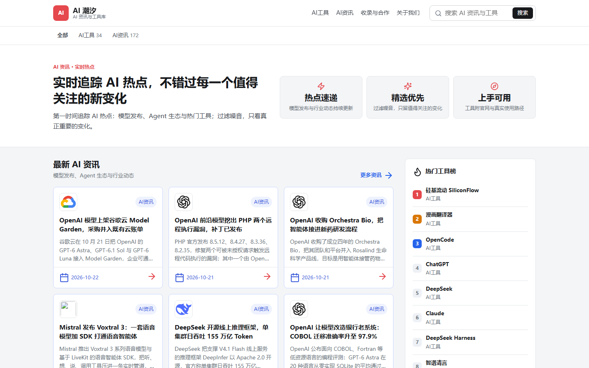
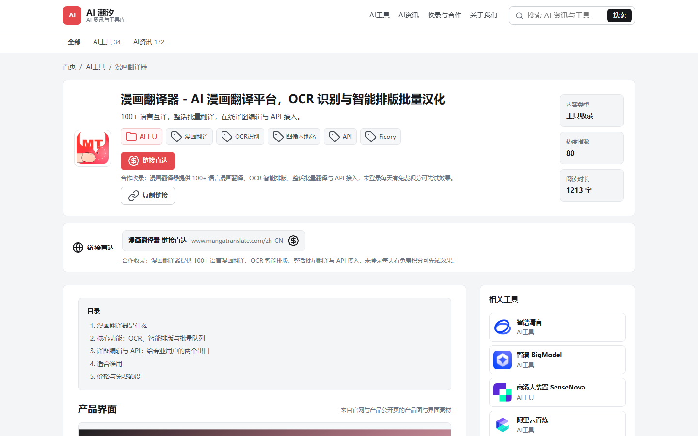

# AI Tides

A self-hosted **AI news + AI tool directory** built entirely on Cloudflare Pages and D1. There is no backend server, no CMS, and no public accounts: content is published through a small REST API and rendered server-side by Pages Functions.

**Live demo:** [ai-blog.cloud](https://ai-blog.cloud)





## Why this exists

The goal is not "build a blog"; it is **turning an AI content source or an automation worker into a deployable, self-updating site** without maintaining a server, a database you must babysit, or a login system for readers.

- **AI news** is written by an automation worker (the bundled Xiaolongxia script, or any bot that can call the API) and published on a schedule.
- **AI tools** are curated manually: each entry keeps the official link, optional referral link, product screenshots, and a structured, useful detail page.
- Readers browse without accounts; the site is pure server-rendered HTML.

## Features

- Cloudflare Pages Functions + D1: static output, dynamic rendering, scheduled publishing, all in one package
- Draft, scheduled (`publishedAt`), or immediate publish with auto-publish on due time
- Admin panel at `/admin`: published posts, scheduled queue, tool library, partner submissions, API keys, worker logs
- Publishing API with `POST /api/posts`, `POST /api/posts/batch`, and a Xiaolongxia hook
- Server-rendered pages with canonical URLs, FAQ schema, breadcrumbs, RSS, sitemap, robots
- Auto-generated tag and category pages; legacy category slugs redirect to `ai-tools`
- Google Analytics 4 and AdSense optional via environment variables; `ads.txt` switches automatically
- Curated referral links loaded from `data/referrals.json`

## Project layout

```
cloudflare/functions        Pages Functions (rendering, admin, API)
cloudflare/wrangler.toml    Pages + D1 config
dist                        built static site (exported)
views                      EJS templates (server-rendered)
lib                        local server helpers + store
scripts                    build, package, publish worker, seed
data                        local seed content and referral config
docs                        deployment notes and images
```

## Quickstart

### 1. Deploy to Cloudflare Pages

Build the deployable package:

```powershell
npm install
& .\scripts\package.ps1 -SiteUrl "https://your-domain.com"
```

Then deploy the generated folder:

```bash
cd release/ai-tides-cloudflare
npx wrangler pages deploy dist --project-name your-project
```

The same directory contains `wrangler.toml` with the D1 binding; the D1 database is created on first use by the function.

### 2. Open the admin panel

Visit `https://your-domain.com/admin`. The first visit asks you to set the admin password; after that, create an API key in the **API keys** panel and use it for publishing. Keys are shown once.

`/admin` is excluded from search engines via `robots.txt`, and admin actions are CSRF-protected with session auth.

### 3. Publish AI news

News is the only category accepted by the API:

```http
POST /api/posts
Authorization: Bearer <your ait_... key>
Content-Type: application/json
```

```json
{
  "title": "Example - vendor ships a new model",
  "slug": "example-ai-news",
  "category": "ai-news",
  "tags": ["AI"],
  "summary": "What happened and why it matters.",
  "cover": { "url": "https://example.com/favicon.ico", "alt": "vendor" },
  "sourceUrl": "https://example.com/news",
  "sections": [
    { "heading": "Background", "body": "<p>why this matters</p>" },
    { "heading": "What changed", "body": "<ul><li>fact 1</li></ul>" }
  ],
  "faq": [{ "q": "Who is affected?", "a": "answer" }],
  "hotScore": 90,
  "publishedAt": "2026-10-22T10:00:00+08:00"
}
```

A future `publishedAt` (or `"status": "scheduled"`) queues the post until it is due and the function publishes it automatically.

### 4. AI tool library

Tools are curated manually. Each tool entry uses `officialUrl`, optional `recommendUrl`/`recommendNote` (renders as a sponsored direct link), screenshots, and structured sections. Referral URLs can be centralized in `data/referrals.json`.

## Analytics and ads

Optional, all configured through environment variables:

| Variable | Purpose |
| --- | --- |
| `ADSENSE_CLIENT` | Google AdSense publisher ID |
| `ADSENSE_SLOTS` | JSON map of ad slot ids; renders real ad units only when set |
| `GOOGLE_ANALYTICS_ID` | GA4 measurement ID |
| `ADS_TXT` | `ads.txt` content override |

When none are set, the site renders clean pages with no ad placeholders.

## Local development

```powershell
npm install
npx -y wrangler pages dev dist --d1 DB --local --port 8787
```

Open `http://localhost:8787` to test `/admin`, API keys, publishing, and page rendering against a local D1 instance.

## Notes on content quality

The bundled worker enforces an editorial standard (source verification, original analysis, required FAQs) because the site is also an AdSense candidate. Rendering relies on real brand icons and structured, useful sections rather than placeholder text.

## License

MIT. See [LICENSE](/LICENSE).
